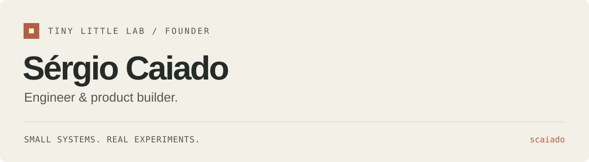

<picture>
  
</picture>

I’m Sérgio, an engineer and product builder, and the founder of
[Tiny Little Lab](https://www.tinylittlelab.com/). I build applied AI tools,
creative systems, and interactive experiments — with an interest in what happens
when an idea becomes something you can actually run.

[The lab](https://www.tinylittlelab.com/) &nbsp; / &nbsp;
[Research & writing](https://www.tinylittlelab.com/research) &nbsp; / &nbsp;
[Public repositories](https://github.com/scaiado?tab=repositories&type=source)

 

## Selected public work

### 01 / Lisbon3D

**Turn city geography into a playable world.** A toy-like Lisbon driving
experiment, pairing an aerial map with a Three.js game space. A separate native
Godot prototype explores the next step.

[Explore the code & run locally](https://github.com/scaiado/lisbon3D#run-locally)
&nbsp; · &nbsp; Browser and native prototypes

 

### 02 / CoderHawk

**Find your bearings in a Swift codebase.** A browser-based file explorer with
an interactive graph, source inspection, search, and export controls. Import
relationships are heuristic; this is a navigation aid, not a compiler analysis.

[Explore the code & run locally](https://github.com/scaiado/coderHawk#run-locally)
&nbsp; · &nbsp; Static browser prototype

 

### 03 / AutoVideo

**Give video generation a usable local workflow.** A web console and CLI for
preparing and tracking avatar video jobs around the external LongCat runtime.
The app is separate from the model; rendering requires compatible CUDA hardware
and weights.

[Explore the code & setup](https://github.com/scaiado/autovideo#start-the-app)
&nbsp; · &nbsp; Local prototype / GPU runtime required

 

---

This is a selection of my own public builds. Forks and learning repositories are kept separate from the work featured here. Project READMEs describe setup, status, and limitations.
